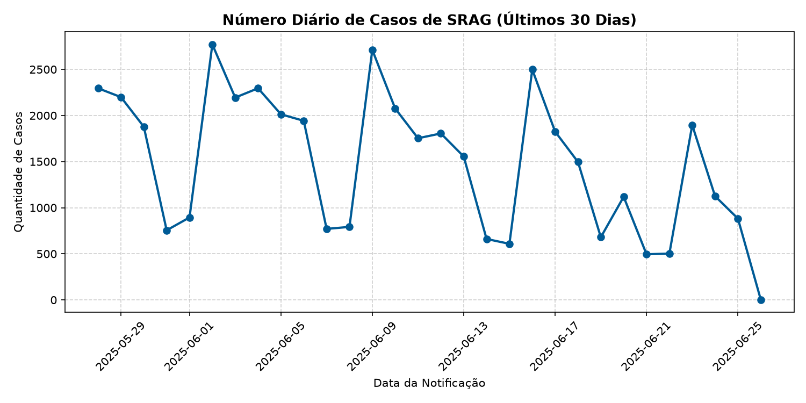
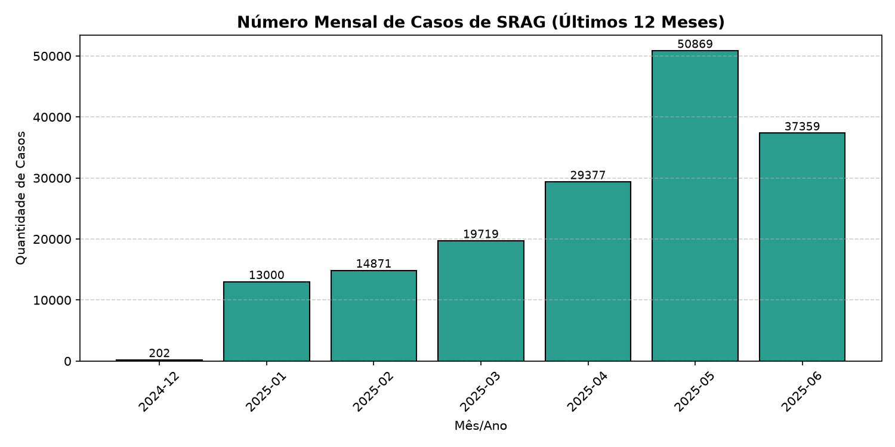

# Relatório de Inteligência Epidemiológica – Monitoramento de SRAG
**Indicium HealthCare | Unidade de Epidemiologia e Engenharia de IA**  
*Data de Emissão:* Outubro de 2024  
*Base de Dados Analisada:* Notificações de Síndrome Respiratória Aguda Grave (SRAG) — SIVEP-Gripe

---

## 1. Sumário Executivo

Este relatório apresenta uma análise detalhada dos dados de Síndrome Respiratória Aguda Grave (SRAG) notificados no território nacional. O objetivo é subsidiar a tomada de decisão clínica, o planejamento da alocação de leitos de terapia intensiva e o direcionamento de campanhas vacinais.

A análise combinou modelagem analítica sobre **165.397 registros** com vigilância ativa de fontes oficiais (Boletins InfoGripe / Fiocruz).

---

## 2. Métricas Epidemiológicas Consolidadas

A tabela abaixo sintetiza os 4 eixos métricos obrigatórios extraídos da base de dados, calculados tanto sobre a totalidade de notificações quanto sobre a coorte de desfechos/respostas preenchidas (casos válidos):

| Dimensão / Métrica | Valor Absoluto | Proporção / Taxa (Base Válida) | Proporção / Taxa (Total Geral) | Interpretação Clínica / Epidemiológica |
| :--- | :---: | :---: | :---: | :--- |
| **Variação de Casos (Últimos 30d vs 30d Anteriores)** | 44.486 vs 48.431 | **-8,15%** | **-8,15%** | Redução recente de 8,15% no ritmo de notificações diárias, indicando desaceleração após período de pico sazonal. |
| **Taxa de Mortalidade por SRAG** | 9.885 óbitos | **7,96%** (de 124.188 desfechos válidos) | **5,98%** (de 165.397 notificações) | Gravidade acentuada dos pacientes hospitalizados; desfecho fatal em ~8% dos pacientes cujo acompanhamento foi concluído. |
| **Taxa de Necessidade de UTI** | 42.519 internações | **29,42%** (de 144.540 registros válidos) | **25,71%** (de 165.397 notificações) | Praticamente 3 em cada 10 pacientes com SRAG exigem suporte ventilatório e cuidados intensivos, demandando alto volume de recursos hospitalares. |
| **Taxa de Vacinação – Covid-19** | 124.808 vacinados | **76,09%** (de 164.025 respostas válidas) | **75,46%** (de 165.397 notificações) | Boa cobertura do esquema vacinal prévio contra Covid-19 entre os indivíduos hospitalizados, refletindo proteção de base populacional. |
| **Taxa de Vacinação – Gripe (Influenza)** | 48.055 vacinados | **32,14%** (de 149.529 respostas válidas) | **29,05%** (de 165.397 notificações) | Baixa cobertura vacinal contra influenza entre os hospitalizados (apenas 32%), evidenciando suscetibilidade ao vírus Influenza A/B. |

---

## 3. Interpretação Clínica e Epidemiológica das Métricas

### 3.1. Dinâmica de Contágio e Variação Mensal (-8,15%)
Houve uma redução de 48.431 para 44.486 casos entre a janela anterior de 30 dias e a atual. Essa estabilização aponta para uma inflexão após semanas de alta transmissão de vírus respiratórios. No entanto, o patamar absoluto mensal (acima de 44 mil casos) ainda impõe sobrecarga às redes de urgência e emergência.

### 3.2. Mortalidade Específica (7,96% nos desfechos definidos)
A letalidade de 7,96% entre casos com evolução conhecida (cura vs. óbito) reforça que a SRAG acomete prioritariamente grupos com imunossenescência, comorbidades cardiopulmonares e faixas etárias extremas. O monitoramento precoce da saturação de oxigênio é crucial para evitar a progressão para falência de múltiplos órgãos.

### 3.3. Pressão sobre Terapia Intensiva (29,42%)
A admissão de quase 30% dos pacientes em leitos de UTI sublinha a dependência crítica de infraestrutura para ventilação mecânica invasiva e não invasiva. Esse indicador orienta os gestores a manter planos de contingência de leitos críticos ativos durante períodos de sazonalidade.

### 3.4. Disparidade Vacinal (Covid-19 76% vs. Influenza 32%)
A expressiva diferença entre a imunização contra Covid-19 (76,09%) e a vacina contra Influenza (32,14%) demonstra que a adesão à vacinação anual da gripe permanece defasada. Como os vírus Influenza A continuam provocando quadros graves em adultos e idosos, essa defasagem é um fator de risco determinante para internação hospitalar.

---

## 4. Evolução Temporal de Casos

Abaixo estão dispostos os comportamentos temporal e sazonal das notificações registradas:

### 4.1. Curva Diária (Últimos 30 Dias)

*Análise da série diária:* Observa-se a oscilação típica de ciclos semanais (menor inserção de dados em finais de semana e feriados) e a manutenção de uma média diária elevada, porém estável, sem tendência explosiva no curto prazo.

### 4.2. Série Histórica Mensal (Últimos 12 Meses)

*Análise da série mensal:* Evidencia o comportamento sazonal característico das síndromes respiratórias agudas graves no Brasil, com ascensão expressiva durante as transições de estação (outono/inverno) e platô persistente decorrente da co-circulação viral.

---

## 5. Contexto Epidemiológico Nacional e Diretrizes Recentes

Conforme os boletins recentes divulgados pelo **Sistema de Vigilância Epidemiológica / InfoGripe da Fiocruz**:
- **Co-circulação Viral:** O cenário epidemiológico nacional é caracterizado pela circulação concomitante do Vírus Sincicial Respiratório (VSR) em faixas pediátricas, de variantes de **Covid-19** e de **Influenza A** nas populações adulta e idosa, com destaque para as regiões Centro-Sul e Sudeste.
- **Vulnerabilidade em Idosos:** O InfoGripe aponta tendência de aumento na proporção de internações de idosos por Covid-19 e Influenza em estados como São Paulo, Rio de Janeiro, Minas Gerais, Goiás e Distrito Federal.
- **Recomendações e Diretrizes:** 
  1. **Reforço Vacinal:** Intensificação de campanhas de vacinação anual contra Influenza e doses de reforço bivalentes para Covid-19, prioritariamente para pessoas com 60+ anos e imunossuprimidos.
  2. **Intervenção Precoce:** Uso oportuno de antivirais (como Oseltamivir nas primeiras 48h para casos de SRAG/Influenza e antivirais orais específicos para Covid-19 em grupos de risco).
  3. **Medidas Não Farmacológicas:** Isolamento respiratório para sintomas gripais e uso de máscaras faciais em ambientes hospitalares e de longa permanência.

---
*Relatório processado e validado via Indicium HealthCare Analytics Engine.*